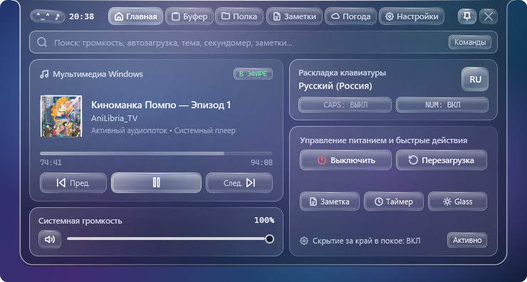
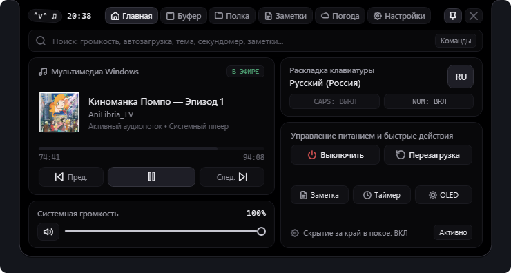
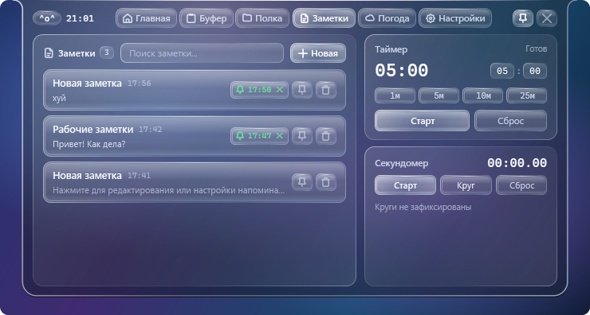
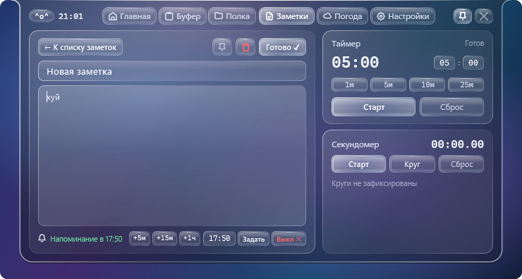
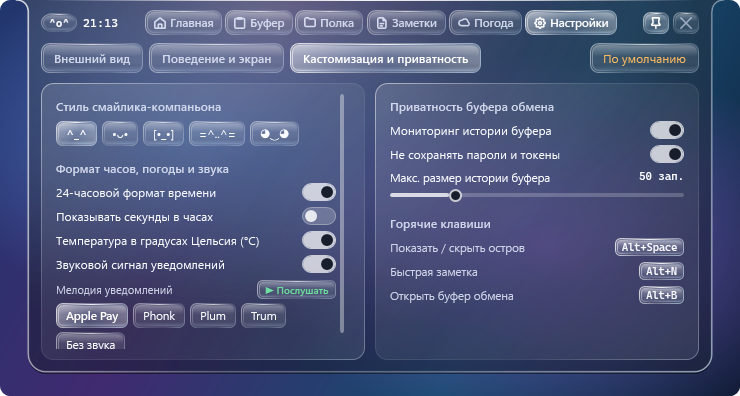
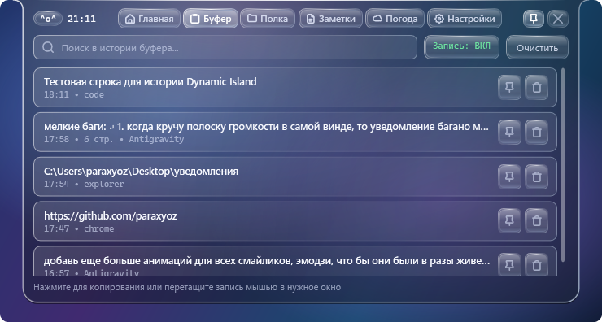
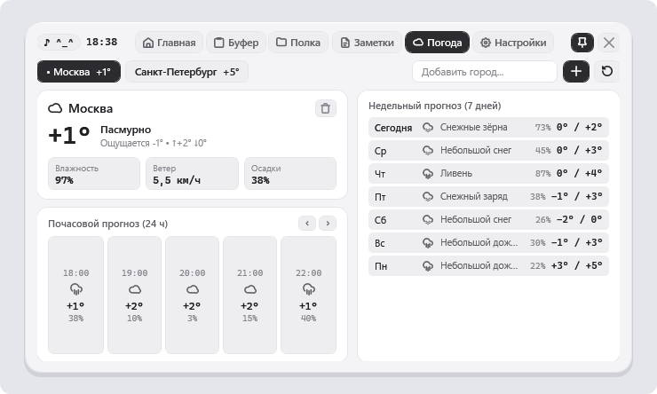

# 🏝️ Windows Dynamic Island

<div align="center">

[](https://github.com/paraxyoz/windows-dynamic-island/releases)
[-0078d4?style=for-the-badge&logo=windows)](https://github.com/paraxyoz/windows-dynamic-island)
[](https://github.com/paraxyoz/windows-dynamic-island)
[](https://github.com/paraxyoz/windows-dynamic-island)
[](https://github.com/paraxyoz/windows-dynamic-island)
[](LICENSE)

<br/>

**Элегантный, молниеносный и функциональный «Динамический остров» для Windows 10 и 11 в стиле Apple Dynamic Island и ультрасовременной эстетике iOS 26 Liquid Glass.**

[Скачать установщик (.exe)](https://github.com/paraxyoz/windows-dynamic-island/releases/latest) • [Портативная версия](https://github.com/paraxyoz/windows-dynamic-island/releases/latest) • [Возможности](#-основные-возможности) • [Горячие клавиши](#-горячие-клавиши) • [Сборка](#-сборка-из-исходников)

<br/>


<br/>



</div>

---

## 🌟 Почему Windows Dynamic Island?

В отличие от громоздких веб-оболочек на Electron, **Windows Dynamic Island** написан на чистом C# и нативном **WPF (.NET Framework 4.8)** с прямым вызовом Win32 / CoreAudio / Windows Runtime API:
- **0% нагрузки на процессор** и видеокарту в состоянии покоя.
- **Потребление ОЗУ всего ~20–30 МБ**.
- **100% клик-сквозь (`HTTRANSPARENT`)** — остров нигде не блокирует клики мыши вне активной капсулы; окна под ним свободно нажимаются и скроллятся.
- **Умное скрытие в полноэкранных играх и фильмах** с отслеживанием именно того монитора, на котором запущен остров.
- **Поддержка любых DPI-масштабов и нескольких мониторов** с авто-подгонкой положения.

---

## 📸 Галерея скриншотов

<div align="center">

### 💎 Тема iOS 26 Liquid Glass & Тёмная OLED
| Тема iOS 26 Liquid Glass | Тёмная тема (OLED Dark) |
| :---: | :---: |
|  |  |

### 📝 Заметки: Отдельный список карточек & Редактор с напоминаниями
| Список отдельных заметок (Поиск, Пин, Быстрое выключение ✕) | Редактор выбранной заметки (+5м, +15м, +1ч, ЧЧ:ММ) |
| :---: | :---: |
|  |  |

### 🔔 Мелодии уведомлений & 📋 Умный буфер обмена
| Выбор звука уведомлений (Apple Pay, Plum, Trum, Phonk) | Буфер обмена с защитой токенов и OLE Drag & Drop |
| :---: | :---: |
|  |  |

### 📂 Файловая полка & 🌤 Реальная погода
| Файловая полка (Drag & Drop ссылки без дублирования) | Прогноз погоды Open-Meteo (24ч и 7 дней) |
| :---: | :---: |
|  |  |

</div>

---

## ✨ Основные возможности

### 1. 💧 Спокойное состояние и адаптивный мениск
- **Капля-мениск:** Прилипает к верхней кромке экрана с плавными вогнутыми ушками, рассчитанными по математическим кубическим кривым Безье.
- **Живой смайлик-компаньон:** 5 вариантов чисто текстовых каомодзи (`^_^`, `•ᴗ•`, `[•_•]`, `=^..^=`, `◕‿◕`). Реагирует на звук, переключение языков, копирование файлов, без навязчивости.
- **Приятный ритм музыки:** При воспроизведении музыки смайлик мягко кивает в такт со стабильной ноткой `♪ ^_^`, без резких прыжков.
- **Часы и погода:** Точное системное время и текущая погода за окном прямо в центре капсулы.

### 2. ⚡ Быстрые тосты и приоритетная очередь уведомлений
- **Плавное вытеснение без задержек:** Быстрые действия (переключение музыки Play/Pause, смена трека, изменение громкости) мгновенно сменяют друг друга без зависания в долгой очереди.
- **Регулировка громкости без мерцания:** Плавный градиентный ползунок откликается на системное колесо громкости с квадратичным сглаживанием 65 мс.
- **Интерактивные напоминания:** Напоминания по заметкам можно закрыть в один клик кнопкой **«Выполнено ✓»** или отложить кнопкой **«Отложить +5м»**.
- **Новые приятные мелодии:** Встроенные чистые звуки (`Apple Pay`, `Plum`, `Trum`, `Phonk`) с предпрослушкой в настройках.

### 3. 📝 Полноценный рабочий стол заметок
- **Каждая заметка отдельно:** Чистый вертикальный список карточек с временем обновления, статусом закрепления и превью текста.
- **Управление напоминаниями в 1 клик:** Зелёная капсула `🔔 18:30 ✕` прямо в карточке заметки отключает напоминание без захода внутрь.
- **Детальный редактор:** Открывается по клику на карточку заметки — заголовок, многострочный текст, кнопки быстрых сдвигов `+5м`, `+15м`, `+1ч` и точный ввод `ЧЧ:ММ`.

### 4. 📋 Умный буфер обмена с защитой приватности
- **Автоматический сбор истории:** Мгновенный перехват через Win32 API без фонового поллинга.
- **Фильтрация паролей:** Автоматически отсекает мастер-пароли, пароли из 1Password/Bitwarden и секретные токены (`sk-...`, `ghp_...`).
- **OLE Drag & Drop:** Вы можете перетащить запись мышью прямо в поле ввода Telegram, Discord, Word или браузер.

### 5. 📁 Файловая полка (Shelf)
- Перетаскивайте файлы и папки прямо на капсулу — полка создаёт лёгкие ссылки без копирования и не тратит место на диске.
- Быстрый доступ к документам и проектам из любого полноэкранного окна.

### 6. ⏱ Таймер и мульти-секундомер
- Быстрые пресеты `1м`, `5м`, `10м`, `25м` (Pomodoro).
- Таймер выводит оставшееся время прямо в свёрнутую капсулу острова.
- Секундомер с фиксацией промежуточных кругов (Laps).

### 7. 🌤 Погода без API-ключей
- Интеграция с открытым метео-сервером Open-Meteo.
- Поиск любых городов мира, почасовой прогноз на 24 часа и недельный прогноз.

---

## ⌨️ Горячие клавиши

| Сочетание клавиш | Действие |
| :--- | :--- |
| <kbd>Alt</kbd> + <kbd>Space</kbd> | Развернуть / свернуть Dynamic Island |
| <kbd>Alt</kbd> + <kbd>N</kbd> | Открыть компактную быструю заметку (или раздел Заметок) |
| <kbd>Alt</kbd> + <kbd>B</kbd> | Мгновенно открыть историю буфера обмена |

---

## 🚀 Установка

### Вариант 1: Автономный инсталлятор (Рекомендуется)
1. Скачайте **[`WindowsDynamicIslandSetup.exe`](https://github.com/paraxyoz/windows-dynamic-island/releases/latest)** из раздела [Releases](https://github.com/paraxyoz/windows-dynamic-island/releases).
2. Запустите установщик. Он автоматически установит приложение, создаст ярлыки в меню Пуск и настроит автозапуск по желанию.
3. *Для тихой автоматической установки:*
   ```powershell
   .\WindowsDynamicIslandSetup.exe --silent
   ```

### Вариант 2: Портативная версия (Portable)
1. Скачайте **[`WindowsDynamicIsland.exe`](https://github.com/paraxyoz/windows-dynamic-island/releases/latest)**.
2. Поместите в любую удобную папку и запустите. Никаких реестров и внешних зависимостей — всё работает из коробки.

---

## 🛠️ Сборка из исходников

Для сборки требуется Windows 10/11 и Visual Studio Build Tools / MSBuild:

```powershell
# Клонируйте репозиторий
git clone https://github.com/paraxyoz/windows-dynamic-island.git
cd windows-dynamic-island

# Запустите скрипт компиляции и прогона тестов
powershell -ExecutionPolicy Bypass -File .\build.ps1
```

Скрипт автоматически:
1. Компилирует проект в конфигурации `Release x64`.
2. Запускает 9/9 автоматических модульных тестов (`WindowsDynamicIsland.Tests.exe`).
3. Собирает установщик `WindowsDynamicIslandSetup.exe` в папку `dist/`.

---

## 🔍 Поисковые теги / SEO Keywords

`windows dynamic island`, `dynamic island for windows 11`, `динамический остров виндовс`, `apple dynamic island pc`, `windows 11 customization`, `glassmorphism widget windows`, `wpf dynamic island`, `desktop productivity tool`, `clipboard manager windows 11`, `ios 26 glass widget`, `windows остров виджет`, `динамический остров на пк`.

---

## 📄 Лицензия

Проект распространяется под свободной и открытой лицензией [MIT](LICENSE). Разработано с душой и вниманием к деталям.

**Автор:** [@paraxyoz](https://github.com/paraxyoz)
