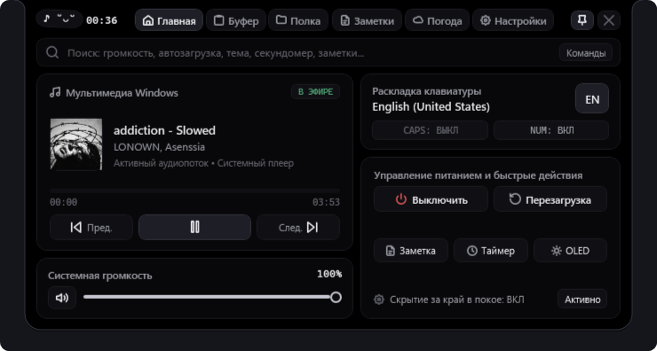
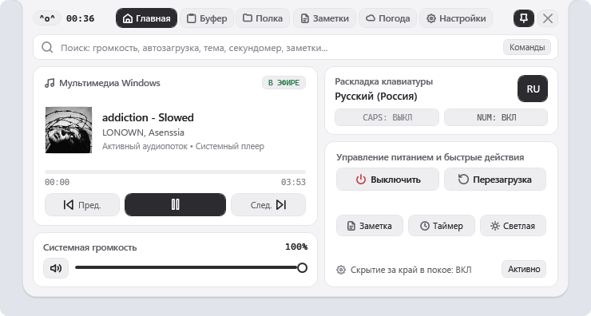

# Windows Dynamic Island

<div align="center">

[](https://github.com/paraxyoz/windows-dynamic-island/releases)
[-0078d4?style=for-the-badge&logo=windows)](https://github.com/paraxyoz/windows-dynamic-island)
[](https://github.com/paraxyoz/windows-dynamic-island)
[](https://github.com/paraxyoz/windows-dynamic-island)
[](https://github.com/paraxyoz/windows-dynamic-island)
[](LICENSE)

<br/>

**Легковесный, нативный и высокопроизводительный «Динамический остров» для Windows 10 и Windows 11.**

[Скачать установщик (.exe)](https://github.com/paraxyoz/windows-dynamic-island/releases/latest) | [Портативная версия](https://github.com/paraxyoz/windows-dynamic-island/releases/latest) | [Возможности](#основные-возможности) | [Горячие клавиши](#горячие-клавиши) | [Сборка](#сборка-из-исходников) | [English Documentation](README.md)

<br/>


<br/>



</div>

---

## Обзор

**Windows Dynamic Island** разработан на **C# и WPF (.NET Framework 4.8)** с использованием нативных API Windows (Win32, CoreAudio COM, Windows Media Session):

- **Минимальное потребление ресурсов:** Около 20–25 МБ оперативной памяти и 0% нагрузки на CPU/GPU в покое.
- **Аппаратная пружинная физика:** Стабильные 120+ FPS без рывков интерфейса.
- **Сквозные клики (`HTTRANSPARENT`):** Только активная капсула перехватывает клики мыши. Все окна под ней остаются кликабельными.
- **Автоматическое скрытие в полноэкранных приложениях:** Скрывается при запуске игр и полноэкранного видео на текущем мониторе.
- **Поддержка нескольких мониторов и любого масштаба DPI:** Корректное позиционирование и масштабирование без размытия интерфейса.

---

## Темы оформления

<div align="center">

| Тёмная тема (OLED Dark) | Светлая тема |
| :---: | :---: |
|  |  |
|  |  |

</div>

---

## Основные возможности

### 1. Свёрнутое состояние и адаптивный мениск
- **Капля-мениск:** Сглаженный контур примыкания к верхней кромке экрана по кубическим кривым Безье.
- **Смайлик-компаньон:** Текстовые каомодзи (`^_^`, `•ᴗ•`, `[•_•]`, `=^..^=`, `◕‿◕`), отражающие статус воспроизведения музыки, раскладку клавиатуры и уведомления.
- **Часы и температура:** Моноширинные часы и актуальная температура за окном в центре капсулы.

### 2. Всплывающие уведомления (Тосты)
- **Мгновенное вытеснение:** Быстрые действия (регулировка громкости, пауза/воспроизведение, переключение треков) сменяют друг друга сразу, без ожидания очереди.
- **Плавный индикатор громкости:** Квадратичное сглаживание без мерцания при регулировке колесом мыши.
- **Системные звуки уведомлений:** Чистые пресеты (`Apple Pay`, `Plum`, `Trum`, `Phonk`) с предпрослушкой в настройках.
- **Интерактивные действия:** Завершение или перенос напоминаний прямо из тоста.

### 3. Рабочее пространство заметок
- **Список карточек:** Отдельное отображение каждой заметки с поиском, закреплением и временем последнего изменения.
- **Управление напоминаниями в один клик:** Быстрое отключение напоминания кнопкой `✕` в списке или детальная настройка сдвига (`+5м`, `+15м`, `+1ч`, точное время `ЧЧ:ММ`).
- **Автоматическое сохранение:** Мгновенное сохранение на диск с созданием резервных копий.

### 4. Буфер обмена с защитой приватности
- **Перехват истории:** Фиксация текста через `WM_CLIPBOARDUPDATE` без фонового опроса.
- **Фильтрация чувствительных данных:** Автоматический пропуск паролей из менеджеров паролей и токенов доступа (`sk-...`, `ghp_...`).
- **OLE Drag & Drop:** Прямое перетаскивание записей мышью в Telegram, Discord, браузер или текстовые редакторы.

### 5. Файловая полка (Shelf)
- Создание ссылок на файлы и папки без дублирования данных на диске.
- Быстрое перетаскивание файлов обратно в проводник или мессенджеры.

### 6. Таймер и секундомер
- Быстрые пресеты на 1, 5, 10 и 25 минут с отображением отсчёта в свёрнутой капсуле.
- Секундомер с фиксацией кругов.

### 7. Погода
- Открытый API Open-Meteo без необходимости регистрации ключей.
- Почасовой прогноз на 24 часа и недельный прогноз на 7 дней.

---

## Горячие клавиши

| Сочетание клавиш | Действие |
| :--- | :--- |
| `Alt + Space` | Развернуть / свернуть Dynamic Island |
| `Alt + N` | Открыть быструю заметку / Заметки |
| `Alt + B` | Открыть историю буфера обмена |

---

## Установка

### Автономный инсталлятор (Рекомендуется)
1. Скачайте **`WindowsDynamicIslandSetup.exe`** со страницы [Releases](https://github.com/paraxyoz/windows-dynamic-island/releases/latest).
2. Запустите установщик. Он установит программу и создаст ярлыки в меню Пуск.
3. Для тихой установки:
   ```powershell
   .\WindowsDynamicIslandSetup.exe --silent
   ```

### Портативная версия
1. Скачайте **`WindowsDynamicIsland.exe`** со страницы [Releases](https://github.com/paraxyoz/windows-dynamic-island/releases/latest).
2. Поместите файл в любую папку и запустите. Никаких реестров или внешних библиотек не требуется.

---

## Сборка из исходников

```powershell
# Клонирование репозитория
git clone https://github.com/paraxyoz/windows-dynamic-island.git
cd windows-dynamic-island

# Сборка и прогон тестов
powershell -ExecutionPolicy Bypass -File .\build.ps1
```

---

## Поисковые теги

`windows dynamic island`, `dynamic island windows 11`, `динамический остров виндовс`, `apple dynamic island pc`, `windows 11 customization`, `wpf desktop widget`, `desktop productivity utility`, `clipboard manager windows`.

---

## Лицензия

Распространяется под свободной лицензией [MIT](LICENSE).

Автор: [@paraxyoz](https://github.com/paraxyoz).
